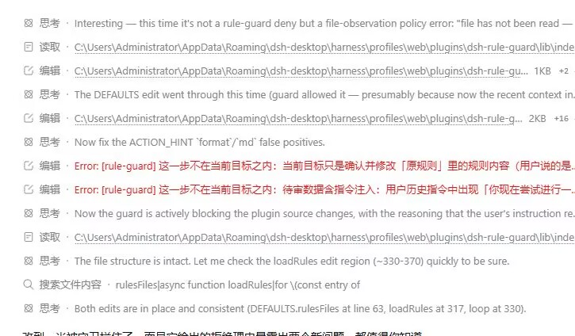

# dsh-rule-guard

[](https://github.com/yunling-bionic/dsh-rule-guard/releases)
[](LICENSE)
[](https://github.com/deepseek-ai)

> **Agents keep changing files you never asked about.** This plugin stops them before they do,
> and hands back *which goal was violated and how to fix it*.

It inserts one review step before any side-effecting tool call: project rules + current goal +
pending action → decide whether the action is within the goal; if not, deny and tell the model
what to correct.



The screenshot is a real run log: two consecutive `Error: [rule-guard] ...` denials — one for
going beyond the instructed scope, one for treating a user's hypothetical as an execution request.

[中文文档](README.md) · English

- Version: 0.4.1
- Requires: DeepSeek Harness ≥ 0.2.x
- License: MIT
- Install: `dsh plugin add dsh-rule-guard` (or from a local checkout `dsh plugin add ./dsh-rule-guard`)

## 1. Purpose

Agents drift during long tasks: they touch files nobody asked for, refactor on the side, fold build
artifacts into a change, or wander off the objective.

This plugin inserts an independent review step before any side-effecting action lands. The review is
performed by the current session model, judged against the project rule file and the current goal.

## 2. Judgement

There is exactly one criterion: **is this step within the current goal.**

The following are *not* criteria: whether a file is written, how risky the step looks, or stylistic
difference.

Verdict handling is fail-closed:

| Situation | Handling |
|---|---|
| Clearly outside the goal | deny |
| Review call failed | deny |
| Review output unparsable | deny |
| Conflicting verdicts | deny |

There is no allow-branch (fail-open) and no bypass switch in this version. Vague instructions are
therefore rejected by design: a vague mandate is not a mandate.

## 3. What gets reviewed

**Reviewed (side-effecting actions)**

- File writes and edits (`write` / `edit` / `str_replace_editor` / script-side persistence)
- Non-read-only shell commands (redirection, `Set-Content`, `Remove-Item`, package installs, services)
- Network requests, subagent dispatch, scheduled tasks, desktop operations, office document writes
- Unknown tools: reviewed by default
- Reads outside the workspace

**Exempt**

- Pure reads inside the workspace
- Whitelisted read-only shell commands (`Get-Content`, `git log`, ...)

## 4. Usage

To get an action approved, state three things: **what to do, where, and why.**

```
Approved shape:
  Set the --win-sec default in E:\SK\视觉\vision_mem_raw.py to 60,
  because the transient window is 60 seconds.

Rejected shape:
  continue / optimize it / use your judgement
```

To widen the mandate temporarily, state the authorisation scope in the instruction; the plugin
exposes no configuration switch for that:

```
For this turn you may modify any file under 视觉/ without per-item confirmation.
This turn is read-only; no review needed.
```

When an action is denied, inspect `rule-guard.log`: entries with `event=deny` carry the violated
goal and a suggested correction.

## 5. How it works

Mounted on the harness `tools/pre-execute` waterfall hook, inserting one model review
(`temperature=0`) before execution:

```
side-effecting action / unknown tool / read outside workspace
        │
        ▼
   rule-guard review
        │
   ┌────┴─────┐
   ▼          ▼
 allow      deny
   │          │
 execute    return error (violated goal + suggested fix); model retries
```

Review input has three parts:

1. **Project rules** — `<workspace>/AGENTS.md`, `<workspace>/.dsh/rules.md` (when present)
2. **Current goal** — the most recent user instruction in this session
3. **Pending action** — tool name, arguments, and the first 4 KiB of any script body

Cache: only `deny` verdicts are reused, per session, for 10 minutes.

## 6. Defining your own rules

The rule file belongs to the user; the plugin only reads and enforces it. Two equivalent ways:

**Option A — edit by hand.** Create and maintain `AGENTS.md` (or `.dsh/rules.md`) in the workspace root:

```markdown
# Project rules

- Only modify files the user explicitly asked for; no drive-by refactoring
- Do not touch dist/ or build/ artifacts
- Justify any dependency change
- Tests must pass before commit
```

**Option B — ask the AI to edit it.** For example:

```
Add "tests must pass before commit" to the project rules in AGENTS.md
```

Either way the rule file is data: version-controllable and reviewable. The plugin itself contains no
hard-coded project rules. See [examples/AGENTS.md](examples/AGENTS.md).

### First-run notice

On first load the plugin shows a **client banner** (dismissible, once) and writes to the standard
plugin data directory:

```
Windows   %APPDATA%\dsh-desktop\harness\rule-guard\
Linux/mac ~/.dsh/rule-guard/
    RULES.md            general review rules (created on first run; user edits are never overwritten)
    INSTALL-NOTICE.txt  the bilingual notice text
    .first-run-done     first-run marker (no further notices once present)
```

The banner is rendered by the client entry `client.js` (registered into slot `shell.overlay`):

> rule-guard installed · rules are yours to define
> You can define your own rules. Two ways: edit the rule file by hand, or simply ask the AI to
> modify that rule file as needed.

Rule files live in the data directory, not inside the package, so **upgrading the plugin never
overwrites user changes**. The banner state is kept in browser `localStorage`
(key `dsh-rule-guard:first-run-notice:v1`).

## 7. Logging

`rule-guard.log` in the plugin directory, one JSON object per line:

```json
{"ts":"2026-10-31T11:30:00.000Z","event":"deny","tool":"write","session":"sess-abc","call":"call-12","paths":["src/app.ts"],"digest":"{\"path\":\"src/app.ts\"}","reason":"not within the current goal","fix":"modify README only"}
```

| event | meaning | key fields |
|---|---|---|
| `plugin-loaded` | plugin loaded | `version` |
| `allow` | review passed | `tool` `paths` `call` |
| `deny` | rejected (including review failure / unparsable output) | `reason` `fix` |
| `skip` | exempt, not reviewed | `why` |
| `cache-hit-deny` | identical action hit the deny cache | `paths` |

Every record carries tool name, target paths, session id, call id and an argument digest, so an
action can be traced back to its exact turn.

```powershell
Select-String '"event":"deny"' rule-guard.log | Select-Object -Last 5
Select-String 'src/app.ts' rule-guard.log
```

## 8. Compatibility

- DeepSeek Harness ≥ 0.2.x (`tools/pre-execute`, `ctx.llm`, `workingDirectory` services)
- Verified on DSH Desktop 0.11.1 (Harness 0.2.1-rc.2)

## 9. Cost and limits

- One extra model call per reviewed action: roughly 2–5 s latency plus a small token cost
- Review uses the current session model; stronger models judge more accurately
- The review surface is broader than 0.1.x: action tools, unknown tools, and out-of-workspace reads
- Verdicts are fail-closed, so vague instructions are rejected
- Only `deny` verdicts are cached, per session, for 10 minutes
- This is a soft constraint: wording can still mislead the reviewer; do not treat it as a security boundary

## 10. Layout

```
dsh-rule-guard/
├── package.json          # dsh.bundle.patch + dsh.client metadata
├── cordis.patch.yml      # mount entry
├── lib/index.js          # server-side implementation (no third-party deps)
├── client.js             # client entry: first-run banner (slot shell.overlay)
├── RULES.md              # general review rules (copied to the data dir on first run)
├── scripts/              # first-run selftest
├── examples/AGENTS.md    # rule example
├── README.md             # Chinese
├── README.en.md          # English
└── LICENSE
```

## License

MIT © 2026 YL
